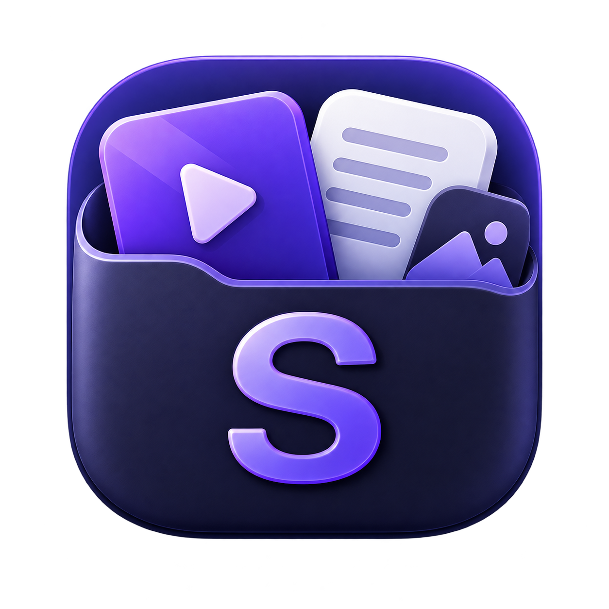

<div align="center">



# Shubhojeet's Videos

**A single-owner video learning journal — save unlisted YouTube explanations, write Markdown notes, and attach private reference images.**

[](https://nextjs.org)
[](https://www.typescriptlang.org)
[](https://react.dev)
[](https://bun.com)
[](https://neon.com)
[](https://orm.drizzle.team)
[](https://vercel.com)

</div>

---

## About

Shubhojeet's Videos is an independently deployable, **single-owner video learning journal**. It lets one approved Google account save unlisted YouTube explanations, write Markdown notes with live preview, and attach private ImageKit reference images.

> **Private by design.** The app is fail-closed: access is granted only when the signed-in Google email exactly matches `OWNER_EMAIL`. Everyone else sees nothing.

## Features

| Feature | Description |
| --- | --- |
| Video entries | Save unlisted YouTube videos with server-validated URL normalization and ID extraction |
| Markdown notes | Split-pane compose & live-preview editor with syntax highlighting |
| Private images | Direct ImageKit uploads with short-lived signed URLs — never publicly accessible |
| Owner-only auth | Better Auth + Google OAuth, strictly allowlisted to a single email |
| Single-owner data model | Every record is scoped to the owner's user ID at the query level |
| Dark / light theme | Theme toggle powered by `next-themes` |
| Zero workflow dependencies | No background-job service required — fully self-contained |

## Architecture

The deployed application has **no runtime dependency on Manus services**. It is a standard Bun-managed Next.js project intended for a user-owned GitHub repository and Vercel project.

| Layer | Service | Purpose |
| --- | --- | --- |
| Application | Next.js 16 App Router on Vercel | Server-rendered journal, route handlers, server actions, and Better Auth endpoints |
| Database | Neon Postgres + Drizzle ORM | Better Auth identities/sessions and owner-scoped journal data |
| Authentication | Better Auth + Google OAuth | Google sign-in, then strict allowlisting by `OWNER_EMAIL` |
| Media | ImageKit | Direct private image upload, CDN transformation, signed image delivery, and cleanup |
| Workflows | None by default | Inngest is intentionally omitted; add it only for durable background features such as transcription or review reminders |

For a deeper dive into the data model, workflows, and implementation choices, see [ARCHITECTURE.md](./ARCHITECTURE.md).

## Getting Started

### Prerequisites

- [Bun](https://bun.com/docs/installation)
- A [Neon](https://neon.com) Postgres project
- A Google Cloud OAuth client (Web application)
- An [ImageKit](https://imagekit.io) account

### Run locally

```bash
# 1. Install dependencies
bun install

# 2. Generate & apply database migrations
bun run db:generate
bun run db:migrate

# 3. Start the dev server
bun run dev
```

### Environment Variables

Copy `.env.example` to `.env.local` and supply your own credentials:

| Variable | Scope | Description |
| --- | --- | --- |
| `DATABASE_URL` | Runtime | Neon **pooled** connection string (`sslmode=require`) |
| `DATABASE_URL_UNPOOLED` | Migrations | Neon direct, non-pooled connection string (`sslmode=require`) |
| `BETTER_AUTH_SECRET` | Server | Secret used to sign Better Auth sessions |
| `BETTER_AUTH_URL` | Server | Public base URL — drives the OAuth callback derivation |
| `GOOGLE_CLIENT_ID` | Server | Google OAuth client ID |
| `GOOGLE_CLIENT_SECRET` | Server | Google OAuth client secret |
| `OWNER_EMAIL` | Server | The single allowlisted Google email — **never leave empty** |
| `IMAGEKIT_PUBLIC_KEY` | Client | ImageKit public API key |
| `IMAGEKIT_PRIVATE_KEY` | Server-only | ImageKit private API key |
| `IMAGEKIT_URL_ENDPOINT` | Client | ImageKit CDN URL endpoint |

## Google OAuth & Owner Access

In Google Cloud Console, create a **Web application** OAuth client. Add these authorised redirect URIs:

```text
http://localhost:3000/api/auth/callback/google
https://your-domain.example/api/auth/callback/google
```

> **Note:** Set `BETTER_AUTH_URL` to the same base production URL. Better Auth derives the provider callback from this value, so mismatches cause Google `redirect_uri_mismatch` errors.

The app is deliberately fail-closed: a signed-in user is granted access only if their Google email exactly matches `OWNER_EMAIL`. Do not leave this variable empty.

## ImageKit Privacy Configuration

The app uploads reference images with `isPrivateFile=true` and renders them with short-lived server-generated signed URLs. In ImageKit, enable **Restrict all requests** for images so that invalid or unsigned URLs return `401 Unauthorized`.

## Deploy to Vercel

1. Create a private GitHub repository and push this code
2. Import it into a Vercel project and select **Bun** as the package manager
3. Set the environment variables from `.env.example` in **Production**
4. Configure the production Vercel domain in both `BETTER_AUTH_URL` and Google Cloud Console
5. Apply migrations using the direct Neon URL before the first public deployment:

```bash
bun run db:migrate
```

> **Tip:** Vercel is suitable for this personal journal on the Hobby plan, but the account must remain within plan limits. Neon's free plan likewise suspends database connections when its monthly compute or transfer quota is exhausted — monitor both provider dashboards.

## Verification Commands

```bash
bun run check                        # TypeScript type-check
bun run test                         # Unit tests (Vitest)
NODE_ENV=production bun run build    # Production build
```

External credential checks are kept separate because they make live network calls:

```bash
bun run test:integration             # Integration tests (live credentials)
```

## Project Structure

```text
learning-video-vault/
├── app/                     # App Router pages, actions & route handlers
│   ├── dashboard/           #   Owner dashboard
│   ├── entries/             #   Entry detail, create & edit routes
│   ├── api/                 #   Auth endpoints & protected upload routes
│   └── actions.ts           #   Server actions
├── components/              # UI components (auth, journal, legal, ui)
├── lib/                     # Core logic — auth, db, schema, imagekit, youtube
├── drizzle/                 # Generated SQL migrations
├── tests/                   # Vitest unit & integration tests
└── drizzle.config.ts        # Drizzle Kit configuration
```

## References

1. [Connect from Drizzle to Neon](https://neon.com/docs/guides/drizzle)
2. [Better Auth — Google provider](https://better-auth.com/docs/authentication/google)
3. [ImageKit — media delivery basic security](https://imagekit.io/docs/media-delivery-basic-security)
4. [Vercel — Hobby plan](https://vercel.com/docs/plans/hobby)
5. [Neon — free plan limits and quotas](https://neon.com/faqs/free-plan-limits-and-quotas)

---

<div align="center">

Built with Next.js · Better Auth · Drizzle · Neon · ImageKit

</div>
